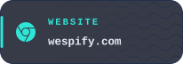
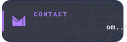
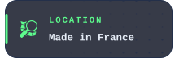
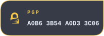
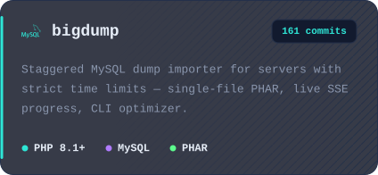
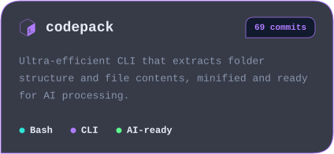
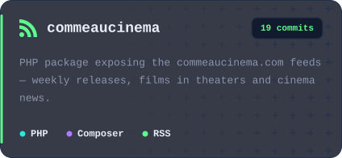
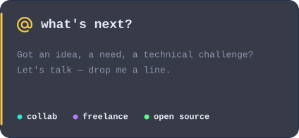
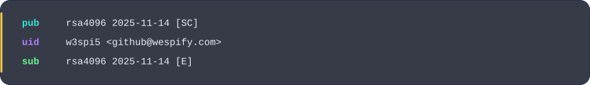

<div align="center">

<a href="https://github.com/kiyomasanaki"></a>

<a href="https://wespify.com"></a>
<a href="mailto:%67%68%2E%70%75%62%2E%6B%6D%40%77%65%73%70%69%66%79%2E%63%6F%6D"></a>
<a href="#"></a>
<a href="#pgp"></a>

</div>

---

<div align="center">
  

  

  
</div>

---

<div align="center">
  

  
  
  
  
</div>

---

<div align="center">
  
</div>

<div align="center">
<a href="https://github.com/kiyomasanaki/bigdump"></a>
<a href="https://github.com/kiyomasanaki/codepack"></a>
<a href="https://github.com/kiyomasanaki/commeaucinema"></a>
<a href="mailto:%67%68%2E%70%75%62%2E%6B%6D%40%77%65%73%70%69%66%79%2E%63%6F%6D"></a>
</div>

---

<div align="center">
  

  
  

  

  
</div>

---

<div align="center">
  

  
</div>

---

<div align="center">
  

  

  

  

</div>

---

<div align="center">
  <a id="pgp"></a>
  



<details>
<summary>Show the full public key</summary>

```text
-----BEGIN PGP PUBLIC KEY BLOCK-----

mDMEaReKGxYJKwYBBAHaRw8BAQdAP69WrJF2dKEn24eWMiiU2YLoXQE177zbzKkV
wzA6qO+0J2dpdGh1Yi53ZXNwaWZ5LmNvbSA8Z2l0aHViQHdlc3BpZnkuY29tPoiZ
BBMWCgBBFiEEoLY7VKDTPAb/6hIZhA2KpJiwURgFAmkXihsCGwMFCT4SZ+UFCwkI
BwICIgIGFQoJCAsCBBYCAwECHgcCF4AACgkQhA2KpJiwURi2EwD/RfKGV4ulJ7kp
GbLQDRfTfwuInO9aaGJQMQs6JsBWZGoA/3/UCcbNCUTxtpm+f0qu/yIbJsuTi81K
hsgfSYE0kdAFuDgEaReKGxIKKwYBBAGXVQEFAQEHQEMwYakHNplpdqxioB1yP42p
911AKgHvK7ZM3UI2DWBOAwEIB4h+BBgWCgAmFiEEoLY7VKDTPAb/6hIZhA2KpJiw
URgFAmkXihsCGwwFCT4SZ+UACgkQhA2KpJiwURj6QQEAtY1V+yx7jWZcHLztg96v
VKvyluRaziIGyVEi+ie2WZcA/1RbR5g5yjD47R2Bl990mPmi4U3l2UjjVD+L8/Dv
VGAA
=E4ac
-----END PGP PUBLIC KEY BLOCK-----
```

</details>


</div>

---

<div align="center">

```ansi
╔══════════════════════════════════════════════════════════════╗
║   "Code is like humor.                                       ║
║    When you have to explain it, it's bad."   — Cory House    ║
╚══════════════════════════════════════════════════════════════╝
```

**Thanks for stopping by. Explore the repos, drop me a line, let's build (or break) something.**

<a href="https://github.com/kiyomasanaki"></a>
<a href="mailto:%67%68%2E%70%75%62%2E%6B%6D%40%77%65%73%70%69%66%79%2E%63%6F%6D"></a>


</div>
